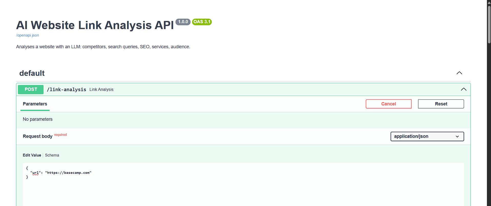
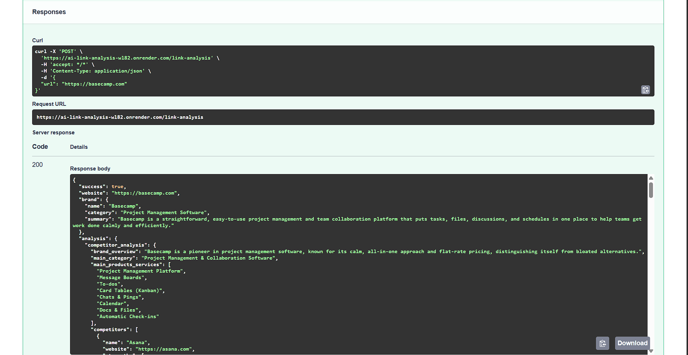

# AI Website Link Analysis API

A FastAPI service that fetches a website, cleans its content, and uses an LLM to generate five analysis sections:
**competitor comparison, top-5 search queries, SEO improvements, top-5 services, and target audience.**

| | |
|---|---|
| **Live demo** | https://ai-link-analysis-wl82.onrender.com |
| **Endpoint** | `POST https://ai-link-analysis-wl82.onrender.com/link-analysis` |
| **API docs** | https://ai-link-analysis-wl82.onrender.com/docs |

> The demo runs on a free Render instance, which sleeps when idle. The first request after a pause can take 30-60 seconds.

## Setup

```bash
python -m venv .venv
source .venv/bin/activate          # Windows: .venv\Scripts\activate
pip install -r requirements.txt
cp .env.example .env               # Windows: copy .env.example .env
# edit .env and add your API key
uvicorn app.main:app --host 0.0.0.0 --port 4000
```

- Docs: http://localhost:4000/docs
- Tests: `pytest` (18 tests; the LLM and network are mocked)
- Docker: `docker build -t link-analysis . && docker run -p 4000:4000 --env-file .env link-analysis`

### Environment variables

| Variable | Purpose |
|---|---|
| `LLM_PROVIDER` / `LLM_MODEL` | Primary provider (`gemini` or `anthropic`) and model id |
| `FALLBACK_PROVIDER` / `FALLBACK_MODEL` | Used if the primary fails |
| `GEMINI_API_KEY` / `ANTHROPIC_API_KEY` | API keys (never committed; `.env` is git-ignored) |
| `CACHE_TTL_SECONDS` | In-memory cache lifetime per URL (default 3600) |

## Usage

```bash
curl -X POST https://ai-link-analysis-wl82.onrender.com/link-analysis \
  -H "Content-Type: application/json" \
  -d '{"url": "https://basecamp.com"}'
```

Response shape:

```
success, website,
brand {name, category, summary},
analysis {
  competitor_analysis, target_search_queries, seo_improvements, top_services, target_audience
},
meta {model, cached, pages_analyzed, content_chars, elapsed_seconds, input_tokens, output_tokens}
```

### Sample response (https://basecamp.com)

<!-- TODO: paste the real JSON you got from the live API for basecamp.com here -->

```json
{
  "success": true,
  "website": "https://basecamp.com",
  "brand": {
    "name": "Basecamp",
    "category": "Project Management Software",
    "summary": "Basecamp is a straightforward, easy-to-use project management and team collaboration platform that puts tasks, files, discussions, and schedules in one place to help teams get work done calmly and efficiently."
  },
  "analysis": {
    "competitor_analysis": {
      "brand_overview": "Basecamp is a pioneer in project management software, known for its calm, all-in-one approach and flat-rate pricing, distinguishing itself from bloated alternatives.",
      "main_category": "Project Management & Collaboration Software",
      "main_products_services": [
        "Project Management Platform",
        "Message Boards",
        "To-dos",
        "Card Tables (Kanban)",
        "Chats & Pings",
        "Calendar",
        "Docs & Files",
        "Automatic Check-ins"
      ],
      "competitors": [
        {
          "name": "Asana",
          "website": "https://asana.com",
          "strengths": [
            "Advanced workflow builder",
            "Extensive integrations",
            "Flexible views"
          ],
          "weaknesses": [
            "Can be complex and overwhelming",
            "Per-user pricing gets expensive"
          ],
          "source": "ai_generated_suggestion"
        },
        {
          "name": "Trello",
          "website": "https://trello.com",
          "strengths": [
            "Intuitive Kanban interface",
            "Easy to get started",
            "Good free tier"
          ],
          "weaknesses": [
            "Lacks built-in native docs and messaging",
            "Requires power-ups for robust functionality"
          ],
          "source": "ai_generated_suggestion"
        },
        {
          "name": "Monday.com",
          "website": "https://monday.com",
          "strengths": [
            "Highly visual dashboards",
            "Great customization",
            "Strong automation capabilities"
          ],
          "weaknesses": [
            "Steep learning curve",
            "Complex tiered pricing structure"
          ],
          "source": "ai_generated_suggestion"
        }
      ],
      "comparison_table": [
        {
          "comparison": "Pricing Model",
          "your_brand": "Affordable flat-rate or simple packaging",
          "competitor": "Per-user pricing that scales up quickly"
        },
        {
          "comparison": "Interface Complexity",
          "your_brand": "Famously straightforward and calm",
          "competitor": "Feature-heavy with steep learning curves"
        },
        {
          "comparison": "Customer Service",
          "your_brand": "24/7/365 human support by knowledgeable staff",
          "competitor": "Mostly tiered ticketing systems and chatbots"
        }
      ],
      "strengths": [
        "20+ years of proven market longevity and brand trust",
        "All-in-one feature set reduces app fatigue",
        "Durable infrastructure with 99.99% uptime",
        "Exceptional 24/7 human customer support"
      ],
      "opportunities": [
        "Expand positioning for AI-agent connectivity (Claude, ChatGPT, etc.)",
        "Target growing remote and hybrid small businesses seeking calm workflows",
        "Capture dissatisfied users escaping bloated, expensive competitors"
      ],
      "note": "Competitors are AI-generated suggestions, not verified market research."
    },
    "target_search_queries": [
      {
        "query": "simple project management software for small teams",
        "platforms": [
          "Google",
          "LinkedIn"
        ],
        "intent": "Commercial",
        "business_relevance": "Directly targets customers looking for straightforward tools instead of bloated enterprise software.",
        "target_audience": "Small business owners, project managers, team leads"
      },
      {
        "query": "best calm project management app",
        "platforms": [
          "Google",
          "X"
        ],
        "intent": "Informational",
        "business_relevance": "Aligns with Basecamp's core brand messaging of providing a calm workspace.",
        "target_audience": "Professionals experiencing app fatigue"
      },
      {
        "query": "how to manage client projects in one place",
        "platforms": [
          "Google",
          "LinkedIn"
        ],
        "intent": "Informational",
        "business_relevance": "Connects with Basecamp's capability to work smoothly with clients.",
        "target_audience": "Agency owners, consultants, freelancers"
      },
      {
        "query": "Basecamp vs Asana project management",
        "platforms": [
          "Google"
        ],
        "intent": "Commercial",
        "business_relevance": "Captures high-intent users actively comparing software options before purchasing.",
        "target_audience": "Evaluating buyers and IT decision-makers"
      },
      {
        "query": "project management tool with integrated chat and kanban",
        "platforms": [
          "Google",
          "Facebook"
        ],
        "intent": "Commercial",
        "business_relevance": "Highlights specific built-in features like Chats & Pings and Card Tables.",
        "target_audience": "Operations managers, team coordinators"
      }
    ],
    "seo_improvements": {
      "primary_keyword": "project management platform",
      "secondary_keywords": [
        "team collaboration software",
        "manage projects online",
        "small business project management"
      ],
      "long_tail_keywords": [
        "simple project management software for remote teams",
        "all in one project management and client communication"
      ],
      "business_keywords": [
        "Basecamp",
        "project management",
        "task tracking",
        "kanban boards"
      ],
      "recommended_title": "Basecamp: The Calm, All-in-One Project Management Platform",
      "title_structure": "Brand: Value Proposition & Core Offering",
      "meta_description": "Trusted by millions, Basecamp puts everything you need to get work done in one place. Manage projects, work with clients, and communicate company-wide.",
      "supporting_content": [
        "Customer success stories and case studies",
        "Live product demonstration webinars and classes",
        "Guides on transitioning from bloated apps to calm project management"
      ]
    },
    "top_services": [
      {
        "name": "Project Management & Task Tracking",
        "description": "Organize work using to-do lists, milestones, and card tables to track accountability and ensure deadlines are met.",
        "target_industry": "Cross-industry",
        "target_customer": "Teams and businesses of all sizes",
        "main_benefit": "Brings all tasks and project details into a single, organized place",
        "source": "website"
      },
      {
        "name": "Internal Communication & Chat",
        "description": "Communicate company-wide using message boards for announcements and chats & pings for group or direct messaging.",
        "target_industry": "Cross-industry",
        "target_customer": "Remote, hybrid, and in-office teams",
        "main_benefit": "Replaces fragmented email chains and external chat apps with clear, searchable discussions",
        "source": "website"
      },
      {
        "name": "Document & File Storage",
        "description": "Store, organize, and share project assets, images, and documents securely within the platform.",
        "target_industry": "Cross-industry",
        "target_customer": "Designers, marketers, publishers, and creators",
        "main_benefit": "Keeps all necessary files right next to the projects and tasks they belong to",
        "source": "website"
      },
      {
        "name": "Client Collaboration",
        "description": "Work directly with external clients inside projects while keeping internal notes private and secure.",
        "target_industry": "Agencies, Consulting, Professional Services",
        "target_customer": "Account managers, consultants, and agency owners",
        "main_benefit": "Simplifies client communication and keeps stakeholders aligned without extra tools",
        "source": "website"
      },
      {
        "name": "AI Agent Integration",
        "description": "Connect AI agents such as Claude, ChatGPT, Muse, and Grok Bot directly to your workflow.",
        "target_industry": "Technology, Software, Digital Marketing",
        "target_customer": "Tech-forward teams and developers",
        "main_benefit": "Enhances productivity by integrating modern AI assistants smoothly into daily tasks",
        "source": "website"
      }
    ],
    "target_audience": {
      "primary_audience": [
        "Small and medium-sized business owners",
        "Project managers",
        "Team leads and department heads"
      ],
      "secondary_audience": [
        "Freelancers and consultants",
        "Non-profit organizations",
        "Remote and hybrid teams"
      ],
      "industries": [
        "Product development",
        "Woodworking",
        "Music industry",
        "Logistics",
        "Publishing",
        "Event planning",
        "Marketing",
        "Architecture",
        "Software design",
        "Education"
      ],
      "business_types": [
        "Small businesses",
        "Agencies",
        "Non-profits",
        "Enterprises"
      ],
      "customer_profiles": [
        "Jugglers of multiple projects and client expectations",
        "Teams suffering from app fatigue and bloated software",
        "Leaders looking for calm, dependable infrastructure"
      ],
      "geographic_focus": "Worldwide",
      "customer_needs": [
        "A straightforward, easy-to-use system to manage work",
        "Consolidation of scattered apps and browser tabs",
        "Reliable uptime and dependable 24/7 human customer service",
        "Affordable pricing for growing teams"
      ],
      "customer_interests": [
        "Productivity and organization",
        "Calm work culture",
        "Streamlined client communication",
        "AI workflow integrations"
      ],
      "recommended_segments": [
        {
          "audience": "Agency Owners",
          "business_type": "Marketing & Creative Agencies",
          "requirement": "Clean client collaboration and reliable task tracking without complex enterprise bloat."
        },
        {
          "audience": "Small Business Teams",
          "business_type": "SMBs",
          "requirement": "An affordable, all-in-one platform to replace multiple chat, storage, and project apps."
        },
        {
          "audience": "Remote Team Leads",
          "business_type": "Distributed Companies",
          "requirement": "Centralized messaging, check-ins, and shared calendars to maintain team alignment across time zones."
        }
      ]
    }
  },
  "meta": {
    "model": "gemini-3.5-flash-lite",
    "cached": false,
    "pages_analyzed": 3,
    "content_chars": 5342,
    "elapsed_seconds": 7.08,
    "input_tokens": 1921,
    "output_tokens": 2459
  }
}
```

### Screenshots

<!-- TODO: add images to a docs/ folder and link them -->



### Error handling

All errors return `{"success": false, "error": {"code", "message"}}`.

| Case | Status | Code | Example input |
|---|---|---|---|
| Invalid URL / host cannot be resolved | 400 | `invalid_url` | `https://nonexistent.invalid` |
| Private/internal address (SSRF) | 403 | `blocked_url` | `http://localhost:4000` |
| Bad request body | 422 | `invalid_request` | `{}` |
| Site unreachable or blocks bots | 502 | `fetch_failed` / `access_restricted` | - |
| Site too slow | 504 | `timeout` | unreachable host |
| LLM failed after retries and fallback | 502 | `llm_failure` | - |

Sample (400):
```json
{"success": false, "error": {"code": "invalid_url", "message": "Could not resolve host 'nonexistent.invalid'."}}
```

## How it works

1. **Validate** the URL (http/https only, no embedded credentials).
2. **SSRF protection:** the hostname is resolved and *every* address must be public. The check is repeated on every redirect hop (redirects are followed manually). Response size is capped at 2 MB and requests have timeouts.
3. **Extract:** title, meta/OG tags, navigation, headings and de-duplicated body text. Scripts, styles, nav and footer are removed. Up to two About/Services pages are fetched for extra context. Content is capped at about 12,000 characters.
4. **Analyse:** a single LLM call returns JSON for all five sections. The output is validated with Pydantic. Invalid JSON gets one repair retry, then the fallback model.
5. **Resilience:** temporary provider errors (429/5xx) are retried with backoff (2s, 5s, 10s). Key or model errors fail fast to the fallback.
6. **Cache:** results are cached in memory per URL (TTL configurable) to avoid repeat LLM calls.

**Honesty rules built into the output**
- No search volumes or rankings are produced, because no data source is integrated.
- Competitors are labelled `ai_generated_suggestion` (not verified market research).
- Services are labelled `website` or `inferred`.

**Known limitations**
- JavaScript-rendered sites with empty HTML return a `no_content` error. A headless browser would be the next step.
- The cache is in memory, so it resets on restart and isn't shared across instances.
- Competitor suggestions come from the model's knowledge, not live research.

## LLM platform research

### Pricing (USD per 1M tokens)

Taken from provider and press pages in Oct-Nov 2026. **Re-check the official pricing pages before relying on them.** Speed and accuracy are shown only where I actually measured them.

| Provider | Model | Input / Output | Context | JSON support | Measured |
|---|---|---|---|---|---|
| Google | `gemini-3.5-flash-lite` | 0.30 / 1.50 (Vertex global list price; confirm AI Studio price) | see docs | Native JSON mode (`responseMimeType`) | **Used in production.** ~8 s on one site (see below) |
| Google | `gemini-4-hydrogen` | not checked | see docs | Native JSON mode | **Failed validation twice**, ~40-55 s per call (see below) |
| Anthropic | `claude-haiku-5-5` | 0.10 / 0.50 (prompts up to 100K tokens; 0.50 / 2.50 above) | 1M | Prompted JSON + Pydantic validation | Not tested (list price only) |
| Anthropic | `claude-sonnet-5-5` | 2.00 / 10.00 | 1M | same | Not tested (list price only) |
| OpenAI | GPT-6 Luna | about 0.10 / 0.50 (one secondary source) | see docs | Structured outputs | Not tested (price unverified) |

### What I actually measured

One site (basecamp.com), a handful of runs, on the live pipeline. This is not a benchmark, just observations:

| Model | Result |
|---|---|
| `gemini-3.5-flash-lite` | Valid JSON, about 8 s per call |
| `gemini-4-hydrogen` | Two attempts, each about 40-55 s, both rejected by validation; the app fell back to flash-lite |
| `gemini-3.5-flash-lite` (live) | One run hit HTTP 503 (provider overload) three times in a row, which led me to add retry with backoff |

I did not run a systematic accuracy benchmark, so I make no claim of "maximum accuracy". `scripts/benchmark.py` measures latency, tokens, cost and JSON validity across models and URLs, and is the way to extend this comparison.

### Recommendation

- **Primary:** `gemini-3.5-flash-lite`. It is the model I measured working, with fast responses and low list price. The task is extraction plus structured generation, which suits a small model.
- **Fallback:** a different provider is the most resilient choice, for example `claude-haiku-5-5` (lowest Anthropic list price) via `FALLBACK_PROVIDER=anthropic`. This is untested here. The provider layer already supports it, and it needs an `ANTHROPIC_API_KEY`.
- **Estimated cost per analysis** (assumption: about 4k input and 2k output tokens; the real counts are returned in `meta`): about $0.004 with flash-lite at list price. This is an estimate, not a measurement.
- **Balancing accuracy, speed and cost:** start with the small model, validate every response, and escalate to the fallback only on failure. Move to a larger model only if the output is not good enough on your test sites.

### Cost optimisation

Implemented:
- Strip HTML noise and duplicate text, with a hard character cap on content sent to the LLM.
- One compact prompt and a single call for all five sections.
- Small model by default; the fallback runs only on failure.
- Per-URL cache to avoid repeated calls.
- Failed provider calls are not retried when the error is a key or model problem.

Recommended next steps:
- Prompt caching for the static system prompt.
- Batch API for bulk jobs (provider discounts apply).
- Keep prompts under the provider's pricing tier thresholds (Haiku 5.5 changes price above 100K tokens).

## Project structure

```
app/
  main.py                    # FastAPI app and endpoint
  config.py                  # settings from environment
  schemas.py                 # Pydantic request/response models
  services/
    website_extractor.py     # safe fetch + HTML cleaning
    llm_service.py           # Gemini / Anthropic clients, retry, JSON parsing
    analysis_service.py      # prompt, validation, fallback, cache
    competitor_service.py    # competitor clean-up
  utils/validators.py        # URL validation + SSRF protection
tests/test_link_analysis.py
scripts/benchmark.py
```
